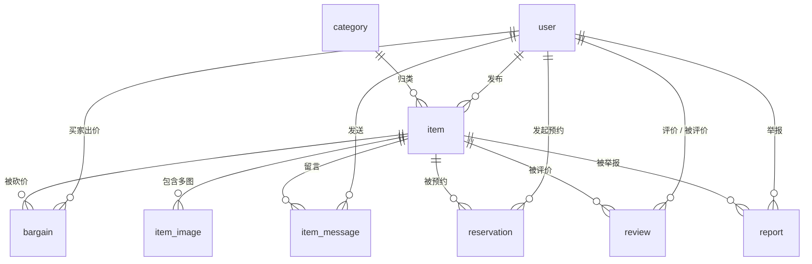

# 智校互联 (CampusHub) 校园二手交易协同平台
## 03. 数据库设计与数据字典规范

> **课程班级**：软件工程 2402 · 第 11 组  
> **制定人员**：边皓东（组长）  
> **生效版本**：v1.0.0（与 01 需求基线 v1.6.0、02 API 契约 v1.0.0 配套）

---

### 一、设计原则

1. **极简原生**：MySQL 8.0 + InnoDB，字符集统一 `utf8mb4`，不引入缓存、消息队列等外部中间件；
2. **图片零文件系统依赖**：商品图片与头像以 Base64 Data URI 直存 `LONGTEXT`（AC-4.3），数据库一键导入即可完整还原演示环境；
3. **主键与时间**：主键统一 `BIGINT` 自增；时间统一 `DATETIME`，创建时间默认 `CURRENT_TIMESTAMP`，更新时间 `ON UPDATE` 自动维护；
4. **状态机清晰**：状态字段使用英文枚举（见 02 文档字典），商品状态机全部通过 `item.status` 表达，不物理删除数据；
5. **参照完整性**：外键显式声明；重复操作拦截优先使用唯一索引兜底（评价、举报），业务状态校验在服务层完成。

---

### 二、E-R 关系总览



核心关系说明：

1. 用户（`user`）是唯一的参与主体：既可以是买家（出价、预约、留言、评价、举报），也可以是卖家（发布商品、处理出价与预约），管理员只是 `role = ADMIN` 的用户；
2. 商品（`item`）属于一个分类与一个卖家，包含多张图片（`item_image`）；
3. 砍价（`bargain`）与预约（`reservation`）都是「买家 × 商品」的交易意向记录，状态流转驱动商品状态联动；
4. 「商品已被预约」不新增商品状态值，由 `reservation` 中 `CONFIRMED` 记录派生（见 4.7 节说明），保证 `item.status` 状态机与 AC-5.2 完全一致。

---

### 三、表清单

| 表名 | 中文名 | 关联模块 | 说明 |
| :--- | :--- | :---: | :--- |
| `user` | 用户 | M1 / M5 | 学生账号 + 管理员（`role`）、禁用状态（`status`） |
| `category` | 商品分类 | M2 / M4 | 6 大分类字典，分类在售数量实时统计 |
| `item` | 商品 | M2 | 状态机：`ON_SALE` / `OFF_SHELF` / `SOLD` |
| `item_image` | 商品图片 | M2 | Base64 Data URI 直存，多图按 `sort_no` 排序 |
| `bargain` | 砍价出价 | M3 | 接受即成交，联动商品与其它出价 |
| `item_message` | 商品留言 | M3 | 留言 / 回复、未读提醒 |
| `reservation` | 意向预约 | M3 | 确认锁定、取消解锁、售出自动关闭 |
| `review` | 信用评价 | M5 | 成交双方互评，唯一约束防重复 |
| `report` | 违规举报 | M5 | 管理员处置（下架 / 驳回）留痕 |

---

### 四、数据字典

#### 4.1 user 用户表

| 字段 | 类型 | 约束 | 说明 |
| :--- | :--- | :--- | :--- |
| id | BIGINT | PK，自增 | 主键 |
| student_no | VARCHAR(20) | NOT NULL，UNIQUE | 登录账号（学号；管理员账号为 `admin`） |
| password | VARCHAR(100) | NOT NULL | BCrypt 哈希，禁止明文（AC-1.2） |
| nickname | VARCHAR(16) | NOT NULL | 昵称 |
| phone | VARCHAR(20) | NOT NULL | 联系电话（卖家名片展示，AC-3.3） |
| avatar | LONGTEXT | NULL | 内联 SVG 头像（Base64 Data URI，AC-1.4） |
| role | VARCHAR(16) | NOT NULL，默认 `USER` | `USER` / `ADMIN` |
| status | VARCHAR(16) | NOT NULL，默认 `ACTIVE` | `ACTIVE` / `DISABLED`（AC-12.2） |
| created_at | DATETIME | NOT NULL，默认当前时间 | 注册时间 |
| updated_at | DATETIME | NOT NULL，自动更新 | 更新时间 |

索引：`uk_student_no (student_no)`。

#### 4.2 category 商品分类表

| 字段 | 类型 | 约束 | 说明 |
| :--- | :--- | :--- | :--- |
| id | BIGINT | PK，自增 | 主键 |
| name | VARCHAR(32) | NOT NULL，UNIQUE | 分类名（教材图书 / 数码 3C / 代步运动 / 生活日用 / 服饰鞋包 / 乐器兴趣） |
| icon | VARCHAR(32) | NULL | 前端内置图标标识 |
| sort_no | INT | NOT NULL，默认 0 | 展示顺序 |
| created_at | DATETIME | NOT NULL，默认当前时间 | 创建时间 |

索引：`uk_name (name)`。分类在售数量为实时聚合查询，不落冗余字段（AC-2.2）。

#### 4.3 item 商品表

| 字段 | 类型 | 约束 | 说明 |
| :--- | :--- | :--- | :--- |
| id | BIGINT | PK，自增 | 主键 |
| seller_id | BIGINT | NOT NULL，FK → user.id | 卖家 |
| category_id | BIGINT | NOT NULL，FK → category.id | 分类 |
| title | VARCHAR(40) | NOT NULL | 标题（2~40 字，AC-4.1） |
| description | TEXT | NULL | 商品描述 |
| price | DECIMAL(10,2) | NOT NULL | 挂牌价（> 0） |
| original_price | DECIMAL(10,2) | NULL | 原价，用于「立省」对比（AC-3.2），可空 |
| condition_level | VARCHAR(16) | NOT NULL | `NEW` / `NEARLY_NEW` / `GOOD` |
| campus | VARCHAR(16) | NOT NULL | `MAIN` / `NANHU` / `WEST` |
| status | VARCHAR(16) | NOT NULL，默认 `ON_SALE` | `ON_SALE` / `OFF_SHELF` / `SOLD`（AC-5.2） |
| view_count | INT | NOT NULL，默认 0 | 浏览量，详情页访问递增（AC-3.4） |
| created_at | DATETIME | NOT NULL，默认当前时间 | 发布时间（默认排序依据） |
| updated_at | DATETIME | NOT NULL，自动更新 | 更新时间 |

索引：`idx_status_category (status, category_id)`、`idx_seller (seller_id, status)`、`idx_created (created_at)`、`idx_campus (campus)`、`idx_condition (condition_level)`。

#### 4.4 item_image 商品图片表

| 字段 | 类型 | 约束 | 说明 |
| :--- | :--- | :--- | :--- |
| id | BIGINT | PK，自增 | 主键 |
| item_id | BIGINT | NOT NULL，FK → item.id（级联删除） | 所属商品 |
| image_data | LONGTEXT | NOT NULL | Base64 Data URI（原图 ≤ 5MB，AC-4.3） |
| sort_no | INT | NOT NULL，默认 0 | 画廊排序 |
| created_at | DATETIME | NOT NULL，默认当前时间 | 上传时间 |

索引：`idx_item (item_id)`。

> 运维提示：5MB 原图 Base64 后约 6.8MB 字符，MySQL 8.0 默认 `max_allowed_packet = 64MB`，无需额外调整；单次发布建议不超过 9 张图。

#### 4.5 bargain 砍价出价表

| 字段 | 类型 | 约束 | 说明 |
| :--- | :--- | :--- | :--- |
| id | BIGINT | PK，自增 | 主键 |
| item_id | BIGINT | NOT NULL，FK → item.id | 目标商品 |
| buyer_id | BIGINT | NOT NULL，FK → user.id | 出价买家 |
| offer_price | DECIMAL(10,2) | NOT NULL | 出价（必须低于挂牌价，AC-6.1） |
| message | VARCHAR(200) | NULL | 出价留言 |
| status | VARCHAR(16) | NOT NULL，默认 `PENDING` | `PENDING` / `ACCEPTED` / `REJECTED` / `CANCELLED` |
| created_at | DATETIME | NOT NULL，默认当前时间 | 出价时间 |
| handled_at | DATETIME | NULL | 处理时间 |

索引：`idx_item_status (item_id, status)`、`idx_buyer (buyer_id, created_at)`。

业务约束（服务层，AC-6.2）：同一 `(item_id, buyer_id)` 不允许存在多条 `PENDING` 记录；接受成交时同事务联动商品与其它出价（见第八节）。

#### 4.6 item_message 商品留言表

| 字段 | 类型 | 约束 | 说明 |
| :--- | :--- | :--- | :--- |
| id | BIGINT | PK，自增 | 主键 |
| item_id | BIGINT | NOT NULL，FK → item.id | 所属商品 |
| sender_id | BIGINT | NOT NULL，FK → user.id | 发送者 |
| receiver_id | BIGINT | NOT NULL，FK → user.id | 接收者（未读提醒对象，AC-9.5） |
| parent_id | BIGINT | NULL | 回复的目标留言 id（空为话题首条） |
| content | VARCHAR(200) | NOT NULL | 留言内容（1~200 字，AC-9.2） |
| is_read | TINYINT | NOT NULL，默认 0 | 0 未读 / 1 已读 |
| created_at | DATETIME | NOT NULL，默认当前时间 | 发送时间 |

索引：`idx_item (item_id, created_at)`、`idx_receiver_read (receiver_id, is_read)`。

#### 4.7 reservation 意向预约表

| 字段 | 类型 | 约束 | 说明 |
| :--- | :--- | :--- | :--- |
| id | BIGINT | PK，自增 | 主键 |
| item_id | BIGINT | NOT NULL，FK → item.id | 目标商品 |
| buyer_id | BIGINT | NOT NULL，FK → user.id | 预约买家 |
| expect_time | DATETIME | NULL | 期望交易时间 |
| remark | VARCHAR(200) | NULL | 备注（如交易地点意向） |
| status | VARCHAR(16) | NOT NULL，默认 `PENDING` | `PENDING` / `CONFIRMED` / `REJECTED` / `CANCELLED` / `CLOSED` |
| created_at | DATETIME | NOT NULL，默认当前时间 | 提交时间 |
| handled_at | DATETIME | NULL | 处理时间 |

索引：`idx_item_status (item_id, status)`、`idx_buyer (buyer_id, created_at)`。

设计说明：

1. **商品锁定为派生状态**：`CONFIRMED` 预约存在时，商品在集市与详情接口中返回 `reserved = true`，不新增 `item.status` 取值，保持商品状态机三态不变（AC-5.2）；
2. 进行中预约定义为 `PENDING` / `CONFIRMED`，同一 `(item_id, buyer_id)` 至多一条进行中记录（服务层保证，AC-10.2）；
3. 商品售出（`SOLD`）时，进行中预约同事务置为 `CLOSED`（AC-10.5）。

#### 4.8 review 信用评价表

| 字段 | 类型 | 约束 | 说明 |
| :--- | :--- | :--- | :--- |
| id | BIGINT | PK，自增 | 主键 |
| item_id | BIGINT | NOT NULL，FK → item.id | 成交商品 |
| reviewer_id | BIGINT | NOT NULL，FK → user.id | 评价人（交易参与方） |
| target_id | BIGINT | NOT NULL，FK → user.id | 被评价人 |
| rating | TINYINT | NOT NULL | 1~5 星 |
| content | VARCHAR(500) | NULL | 文字评价 |
| created_at | DATETIME | NOT NULL，默认当前时间 | 评价时间 |

索引：`uk_item_reviewer (item_id, reviewer_id)`（唯一约束防重复评价，AC-11.2）、`idx_target (target_id)`。

#### 4.9 report 违规举报表

| 字段 | 类型 | 约束 | 说明 |
| :--- | :--- | :--- | :--- |
| id | BIGINT | PK，自增 | 主键 |
| item_id | BIGINT | NOT NULL，FK → item.id | 被举报商品 |
| reporter_id | BIGINT | NOT NULL，FK → user.id | 举报人 |
| reason | VARCHAR(16) | NOT NULL | `FAKE` / `ILLEGAL` / `SCAM` / `OTHER` |
| detail | VARCHAR(500) | NULL | 补充说明 |
| status | VARCHAR(16) | NOT NULL，默认 `PENDING` | `PENDING` / `OFF_SHELF` / `REJECTED` |
| handled_by | BIGINT | NULL，FK → user.id | 处置管理员 |
| handled_at | DATETIME | NULL | 处置时间 |
| created_at | DATETIME | NOT NULL，默认当前时间 | 举报时间 |

索引：`uk_item_reporter (item_id, reporter_id)`（同一用户对同一商品仅能举报一次，AC-11.3）、`idx_status (status, created_at)`。

---

### 五、索引策略

| 查询场景 | 使用索引 | 说明 |
| :--- | :--- | :--- |
| 集市列表（状态 + 分类 + 时间倒序） | `item.idx_status_category` + `idx_created` | 覆盖主查询路径（AC-2.1 / 2.2） |
| 卖家「我的发布」 | `item.idx_seller` | 按卖家 + 状态过滤（AC-5.1） |
| 校区 / 成色筛选 | `item.idx_campus` / `idx_condition` | 联合筛选时由优化器选择 |
| 关键词模糊匹配 | 暂不建索引 | 演示数据规模（32 商品）下 `LIKE '%kw%'` 可接受；如需扩展可启用 MySQL 8 全文索引：`FULLTEXT(title, description) WITH PARSER ngram` |
| 砍价进行中校验 / 列表 | `bargain.idx_item_status`、`idx_buyer` | AC-6.2 / 6.6 |
| 预约进行中校验 / 锁定判定 | `reservation.idx_item_status` | AC-10.2 / 10.3 |
| 留言未读提醒 | `item_message.idx_receiver_read` | AC-9.5 |
| 防重复评价 / 举报 | `review.uk_item_reviewer`、`report.uk_item_reporter` | 唯一索引兜底，冲突返回 4005 |
| 后台举报队列 | `report.idx_status` | 按状态 + 时间处理（AC-12.4） |

---

### 六、MySQL 8.0 DDL 建表脚本

> 以下脚本与 `db/init.sql` 一致，由 `db/init-db.bat` 一键重建（AC-7.3）。

```sql
-- 演示环境重建脚本：先删库再建库，请勿在生产环境执行
DROP DATABASE IF EXISTS campushub;
CREATE DATABASE campushub
  DEFAULT CHARACTER SET utf8mb4
  DEFAULT COLLATE utf8mb4_0900_ai_ci;
USE campushub;

-- 1. 用户表
CREATE TABLE `user` (
  `id`         BIGINT       NOT NULL AUTO_INCREMENT COMMENT '主键',
  `student_no` VARCHAR(20)  NOT NULL COMMENT '登录账号（学号；管理员为 admin）',
  `password`   VARCHAR(100) NOT NULL COMMENT 'BCrypt 哈希密码',
  `nickname`   VARCHAR(16)  NOT NULL COMMENT '昵称',
  `phone`      VARCHAR(20)  NOT NULL COMMENT '联系电话',
  `avatar`     LONGTEXT              COMMENT '内联 SVG 头像（Base64 Data URI）',
  `role`       VARCHAR(16)  NOT NULL DEFAULT 'USER'   COMMENT 'USER / ADMIN',
  `status`     VARCHAR(16)  NOT NULL DEFAULT 'ACTIVE' COMMENT 'ACTIVE / DISABLED',
  `created_at` DATETIME     NOT NULL DEFAULT CURRENT_TIMESTAMP COMMENT '创建时间',
  `updated_at` DATETIME     NOT NULL DEFAULT CURRENT_TIMESTAMP ON UPDATE CURRENT_TIMESTAMP COMMENT '更新时间',
  PRIMARY KEY (`id`),
  UNIQUE KEY `uk_student_no` (`student_no`)
) ENGINE = InnoDB COMMENT = '用户';

-- 2. 商品分类表
CREATE TABLE `category` (
  `id`         BIGINT      NOT NULL AUTO_INCREMENT COMMENT '主键',
  `name`       VARCHAR(32) NOT NULL COMMENT '分类名',
  `icon`       VARCHAR(32)          COMMENT '图标标识',
  `sort_no`    INT         NOT NULL DEFAULT 0 COMMENT '展示顺序',
  `created_at` DATETIME    NOT NULL DEFAULT CURRENT_TIMESTAMP COMMENT '创建时间',
  PRIMARY KEY (`id`),
  UNIQUE KEY `uk_name` (`name`)
) ENGINE = InnoDB COMMENT = '商品分类';

-- 3. 商品表
CREATE TABLE `item` (
  `id`              BIGINT        NOT NULL AUTO_INCREMENT COMMENT '主键',
  `seller_id`       BIGINT        NOT NULL COMMENT '卖家 user.id',
  `category_id`     BIGINT        NOT NULL COMMENT '分类 category.id',
  `title`           VARCHAR(40)   NOT NULL COMMENT '标题',
  `description`     TEXT                   COMMENT '描述',
  `price`           DECIMAL(10,2) NOT NULL COMMENT '挂牌价',
  `original_price`  DECIMAL(10,2)          COMMENT '原价（可空）',
  `condition_level` VARCHAR(16)   NOT NULL COMMENT 'NEW / NEARLY_NEW / GOOD',
  `campus`          VARCHAR(16)   NOT NULL COMMENT 'MAIN / NANHU / WEST',
  `status`          VARCHAR(16)   NOT NULL DEFAULT 'ON_SALE' COMMENT 'ON_SALE / OFF_SHELF / SOLD',
  `view_count`      INT           NOT NULL DEFAULT 0 COMMENT '浏览量',
  `created_at`      DATETIME      NOT NULL DEFAULT CURRENT_TIMESTAMP COMMENT '创建时间',
  `updated_at`      DATETIME      NOT NULL DEFAULT CURRENT_TIMESTAMP ON UPDATE CURRENT_TIMESTAMP COMMENT '更新时间',
  PRIMARY KEY (`id`),
  KEY `idx_status_category` (`status`, `category_id`),
  KEY `idx_seller` (`seller_id`, `status`),
  KEY `idx_created` (`created_at`),
  KEY `idx_campus` (`campus`),
  KEY `idx_condition` (`condition_level`),
  CONSTRAINT `fk_item_seller`   FOREIGN KEY (`seller_id`)   REFERENCES `user` (`id`),
  CONSTRAINT `fk_item_category` FOREIGN KEY (`category_id`) REFERENCES `category` (`id`)
) ENGINE = InnoDB COMMENT = '商品';

-- 4. 商品图片表
CREATE TABLE `item_image` (
  `id`         BIGINT   NOT NULL AUTO_INCREMENT COMMENT '主键',
  `item_id`    BIGINT   NOT NULL COMMENT '所属商品 item.id',
  `image_data` LONGTEXT NOT NULL COMMENT 'Base64 Data URI（原图 ≤ 5MB）',
  `sort_no`    INT      NOT NULL DEFAULT 0 COMMENT '画廊排序',
  `created_at` DATETIME NOT NULL DEFAULT CURRENT_TIMESTAMP COMMENT '创建时间',
  PRIMARY KEY (`id`),
  KEY `idx_item` (`item_id`),
  CONSTRAINT `fk_image_item` FOREIGN KEY (`item_id`) REFERENCES `item` (`id`) ON DELETE CASCADE
) ENGINE = InnoDB COMMENT = '商品图片';

-- 5. 砍价出价表
CREATE TABLE `bargain` (
  `id`          BIGINT        NOT NULL AUTO_INCREMENT COMMENT '主键',
  `item_id`     BIGINT        NOT NULL COMMENT '目标商品 item.id',
  `buyer_id`    BIGINT        NOT NULL COMMENT '买家 user.id',
  `offer_price` DECIMAL(10,2) NOT NULL COMMENT '出价',
  `message`     VARCHAR(200)           COMMENT '出价留言',
  `status`      VARCHAR(16)   NOT NULL DEFAULT 'PENDING' COMMENT 'PENDING / ACCEPTED / REJECTED / CANCELLED',
  `created_at`  DATETIME      NOT NULL DEFAULT CURRENT_TIMESTAMP COMMENT '出价时间',
  `handled_at`  DATETIME               COMMENT '处理时间',
  PRIMARY KEY (`id`),
  KEY `idx_item_status` (`item_id`, `status`),
  KEY `idx_buyer` (`buyer_id`, `created_at`),
  CONSTRAINT `fk_bargain_item`  FOREIGN KEY (`item_id`)  REFERENCES `item` (`id`),
  CONSTRAINT `fk_bargain_buyer` FOREIGN KEY (`buyer_id`) REFERENCES `user` (`id`)
) ENGINE = InnoDB COMMENT = '砍价出价';

-- 6. 商品留言表
CREATE TABLE `item_message` (
  `id`          BIGINT       NOT NULL AUTO_INCREMENT COMMENT '主键',
  `item_id`     BIGINT       NOT NULL COMMENT '所属商品 item.id',
  `sender_id`   BIGINT       NOT NULL COMMENT '发送者 user.id',
  `receiver_id` BIGINT       NOT NULL COMMENT '接收者 user.id',
  `parent_id`   BIGINT                COMMENT '回复目标留言 id（空为话题首条）',
  `content`     VARCHAR(200) NOT NULL COMMENT '留言内容',
  `is_read`     TINYINT      NOT NULL DEFAULT 0 COMMENT '0 未读 / 1 已读',
  `created_at`  DATETIME     NOT NULL DEFAULT CURRENT_TIMESTAMP COMMENT '发送时间',
  PRIMARY KEY (`id`),
  KEY `idx_item` (`item_id`, `created_at`),
  KEY `idx_receiver_read` (`receiver_id`, `is_read`),
  CONSTRAINT `fk_message_item`     FOREIGN KEY (`item_id`)     REFERENCES `item` (`id`),
  CONSTRAINT `fk_message_sender`   FOREIGN KEY (`sender_id`)   REFERENCES `user` (`id`),
  CONSTRAINT `fk_message_receiver` FOREIGN KEY (`receiver_id`) REFERENCES `user` (`id`)
) ENGINE = InnoDB COMMENT = '商品留言';

-- 7. 意向预约表
CREATE TABLE `reservation` (
  `id`          BIGINT       NOT NULL AUTO_INCREMENT COMMENT '主键',
  `item_id`     BIGINT       NOT NULL COMMENT '目标商品 item.id',
  `buyer_id`    BIGINT       NOT NULL COMMENT '买家 user.id',
  `expect_time` DATETIME              COMMENT '期望交易时间',
  `remark`      VARCHAR(200)          COMMENT '备注',
  `status`      VARCHAR(16)  NOT NULL DEFAULT 'PENDING' COMMENT 'PENDING / CONFIRMED / REJECTED / CANCELLED / CLOSED',
  `created_at`  DATETIME     NOT NULL DEFAULT CURRENT_TIMESTAMP COMMENT '提交时间',
  `handled_at`  DATETIME              COMMENT '处理时间',
  PRIMARY KEY (`id`),
  KEY `idx_item_status` (`item_id`, `status`),
  KEY `idx_buyer` (`buyer_id`, `created_at`),
  CONSTRAINT `fk_reservation_item`  FOREIGN KEY (`item_id`)  REFERENCES `item` (`id`),
  CONSTRAINT `fk_reservation_buyer` FOREIGN KEY (`buyer_id`) REFERENCES `user` (`id`)
) ENGINE = InnoDB COMMENT = '意向预约';

-- 8. 信用评价表
CREATE TABLE `review` (
  `id`          BIGINT       NOT NULL AUTO_INCREMENT COMMENT '主键',
  `item_id`     BIGINT       NOT NULL COMMENT '成交商品 item.id',
  `reviewer_id` BIGINT       NOT NULL COMMENT '评价人 user.id',
  `target_id`   BIGINT       NOT NULL COMMENT '被评价人 user.id',
  `rating`      TINYINT      NOT NULL COMMENT '1~5 星',
  `content`     VARCHAR(500)          COMMENT '文字评价',
  `created_at`  DATETIME     NOT NULL DEFAULT CURRENT_TIMESTAMP COMMENT '评价时间',
  PRIMARY KEY (`id`),
  UNIQUE KEY `uk_item_reviewer` (`item_id`, `reviewer_id`),
  KEY `idx_target` (`target_id`),
  CONSTRAINT `fk_review_item`     FOREIGN KEY (`item_id`)     REFERENCES `item` (`id`),
  CONSTRAINT `fk_review_reviewer` FOREIGN KEY (`reviewer_id`) REFERENCES `user` (`id`),
  CONSTRAINT `fk_review_target`   FOREIGN KEY (`target_id`)   REFERENCES `user` (`id`)
) ENGINE = InnoDB COMMENT = '信用评价';

-- 9. 违规举报表
CREATE TABLE `report` (
  `id`          BIGINT       NOT NULL AUTO_INCREMENT COMMENT '主键',
  `item_id`     BIGINT       NOT NULL COMMENT '被举报商品 item.id',
  `reporter_id` BIGINT       NOT NULL COMMENT '举报人 user.id',
  `reason`      VARCHAR(16)  NOT NULL COMMENT 'FAKE / ILLEGAL / SCAM / OTHER',
  `detail`      VARCHAR(500)          COMMENT '补充说明',
  `status`      VARCHAR(16)  NOT NULL DEFAULT 'PENDING' COMMENT 'PENDING / OFF_SHELF / REJECTED',
  `handled_by`  BIGINT                COMMENT '处置管理员 user.id',
  `handled_at`  DATETIME              COMMENT '处置时间',
  `created_at`  DATETIME     NOT NULL DEFAULT CURRENT_TIMESTAMP COMMENT '举报时间',
  PRIMARY KEY (`id`),
  UNIQUE KEY `uk_item_reporter` (`item_id`, `reporter_id`),
  KEY `idx_status` (`status`, `created_at`),
  CONSTRAINT `fk_report_item`     FOREIGN KEY (`item_id`)     REFERENCES `item` (`id`),
  CONSTRAINT `fk_report_reporter` FOREIGN KEY (`reporter_id`) REFERENCES `user` (`id`),
  CONSTRAINT `fk_report_handler`  FOREIGN KEY (`handled_by`)  REFERENCES `user` (`id`)
) ENGINE = InnoDB COMMENT = '违规举报';
```

---

### 七、种子数据说明

1. **数据规模**：14 个用户（13 名学生 + 1 个管理员 `admin`，演示密码统一 `123456`，BCrypt 存储）、6 个分类、32 个商品、45 张商品图片、5 条砍价记录，与 AC-7.3 一致；商品图片与头像均为 Base64 Data URI，导入即还原演示环境；
2. **分类初始数据**（`db/init.sql` 片段示例）：

```sql
INSERT INTO `category` (`name`, `icon`, `sort_no`) VALUES
  ('教材图书', 'book',   1),
  ('数码 3C',  'device', 2),
  ('代步运动', 'bike',   3),
  ('生活日用', 'daily',  4),
  ('服饰鞋包', 'clothes',5),
  ('乐器兴趣', 'music',  6);
```

3. **默认演示账号**：组长账号 `542412320201` / `123456`；管理员账号 `admin` / `123456`（用于管理后台演示）；
4. 留言、预约、评价、举报表随 Sprint 2~3 开发补充演示数据，重建入口统一为 `db\init-db.bat`。

---

### 八、关键事务与数据一致性

| 业务场景 | 事务内操作 | 关联 AC |
| :--- | :--- | :--- |
| 砍价成交 | 出价 → `ACCEPTED`；商品 → `SOLD`；同商品其它 `PENDING` 出价 → `REJECTED` | AC-6.4 |
| 商品售出 | 进行中预约（`PENDING` / `CONFIRMED`）→ `CLOSED` | AC-10.5 |
| 预约确认 | 预约 → `CONFIRMED`；派生商品 `reserved = true` 锁定 | AC-10.3 |
| 预约拒绝 / 取消 | 预约 → `REJECTED` / `CANCELLED`；商品解锁 | AC-10.4 |
| 举报处置 | 举报 → `OFF_SHELF` / `REJECTED`；`OFF_SHELF` 时商品强制下架；记录 `handled_by` / `handled_at` | AC-11.5、AC-12.4 |
| 账号禁用 | 用户 → `DISABLED`；登录接口拦截（4007） | AC-12.2 |
| 详情页浏览 | 商品 `view_count + 1` | AC-3.4 |
| 留言已读 | 接收者读取后 `is_read = 1`，驱动未读角标 | AC-9.5 |
